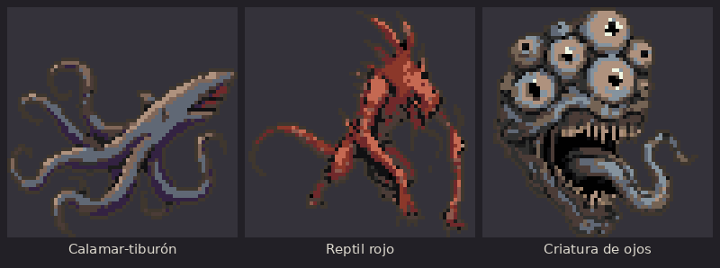
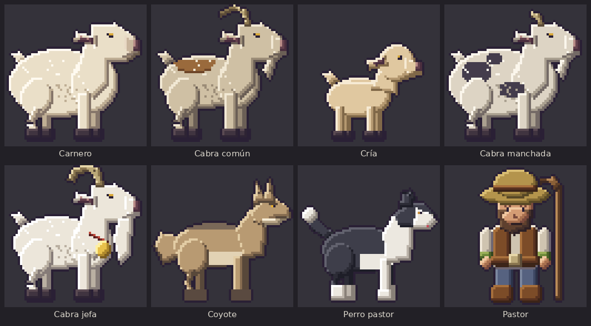
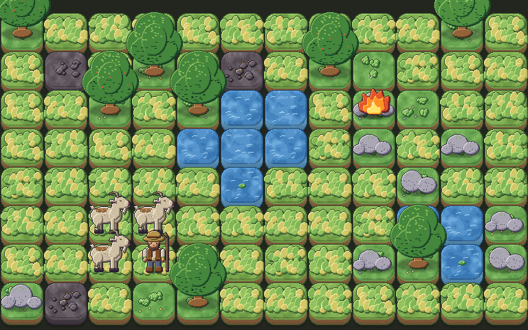

# Sprite Forge (Forja de Sprites)

Turn your **sketches into pixel-art sprites** ready for a 2D game. You draw the shape,
describe the character, and get variants that follow your sketch, share the game's
mood and use **exactly the palette** of your style. Then animate them and generate
terrain for Tiled.

> The code, UI and most docs are in Spanish. This page is the English entry point;
> the key guide, [docs/motores-ia.md](docs/motores-ia.md) (AI engines), is Spanish too,
> and summarized below.


## Gallery

Creatures made with the tool itself (`criaturas-64` preset, `horror-grotesco` project)
from sketches and Spanish descriptions; each sprite comes out at 64×64 in the style's
palette, shown here at ×4.



And a flock with its animals and the shepherd, sprites from a real game made with the tool:



And part of its map, built from individual tiles generated with the tool:



## Why it's different

- **The style is enforced by code, not by the AI.** The AI only paints the large
  image. Cropping and pixelizing (exact palette, size, outline) are local and
  deterministic, so every character stays consistent.
- **Three interchangeable AI engines**, same final style whichever you pick.
- **A style preset is defined by 2–5 example sprites.** No training.
- **Covers the whole pipeline:** projects, animation, spritesheets (PNG + Aseprite
  JSON), maps for Tiled.

## AI engines

| | Libraries (local) | Own server | Gemini |
|---|---|---|---|
| What | SDXL + ControlNet + IP-Adapter on your GPU | Qwen-Image on your network | Google API |
| Cost / privacy | Free, nothing leaves your machine | Free, stays on your network | Paid; sketch and text are sent to Google |
| Key | No | No | Yes (secret, kept outside the repo) |
| `--motor` | `local` | `qwen` | `gemini` |

- **Local**: `pip install -e '.[ia]'`, install PyTorch for your GPU, then
  `forja-modelos descargar` (~14 GB, never committed).
- **Own server**: any server exposing `GET /api/health` and OpenAI-style
  `POST /v1/images/edits`; set its URL in Settings or with `QWEN_URL`.
- **Gemini**: set `GEMINI_API_KEY` or paste it in Settings. It is stored in
  `~/.config/forja-sprites/config.json` (mode `600`, outside the repo), never returned
  by the local API and never logged. Never commit keys.
- **Your own engine**: pass `generador=` to `forjar()`; see the last section of
  [docs/motores-ia.md](docs/motores-ia.md).

## Included examples (all CC0)

| Preset | Size | Source |
|---|---|---|
| `aventura-16` | 16×16 | Tiny Dungeon by Kenney |
| `heroes-mazmorra` | 16×28 | 16x16 DungeonTileset II by 0x72 |
| `criaturas-64` | 64×64 | Openmon Monster Sprites by Screen Smith |

Example projects live in `proyectos/`; start with **`fantasia-rpg`**. See
[CREDITOS.md](CREDITOS.md).


## Quick start (no GPU)

```bash
git clone https://github.com/tapiagarrido/spriteforge.git && cd spriteforge
python3 -m venv .venv && .venv/bin/pip install -e '.[dev]'
.venv/bin/forja-proyectos listar
.venv/bin/python scripts/demo_pixelizado.py presets/aventura-16 demo.png
.venv/bin/forja-animar presets/aventura-16/ejemplo2_caballero.png -o animacion
.venv/bin/forja-servidor            # app at http://127.0.0.1:8765
```

Sketch → sprites with AI:

```bash
.venv/bin/forja-generar ejemplos/bocetos/guerrero_digital.png --proyecto fantasia-rpg \
    --prompt "knight with red armor, round shield and short sword" --motor local
```

Step-by-step (Spanish): [docs/inicio-rapido.md](docs/inicio-rapido.md).

## Development

```bash
.venv/bin/pytest -q && .venv/bin/ruff check .
```

See [CONTRIBUTING.md](CONTRIBUTING.md) and [SECURITY.md](SECURITY.md).
Code: MIT ([LICENSE](LICENSE)). Example sprites: CC0. AI models have their own
licenses: [docs/modelos.md](docs/modelos.md).
