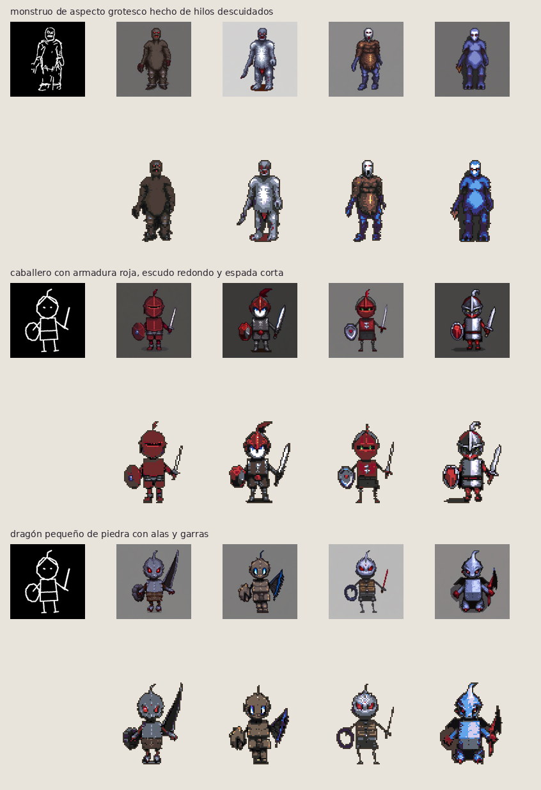
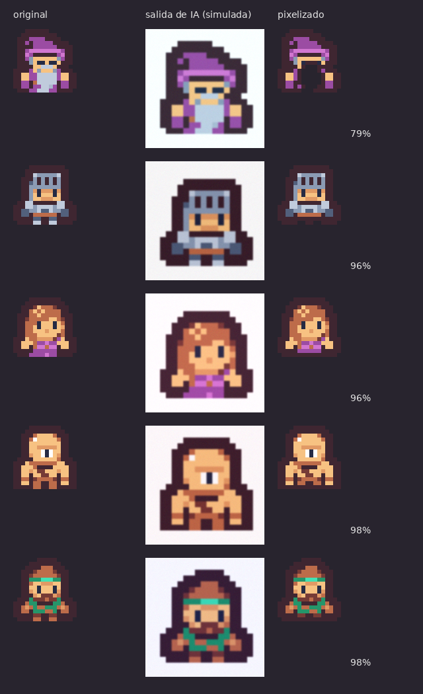
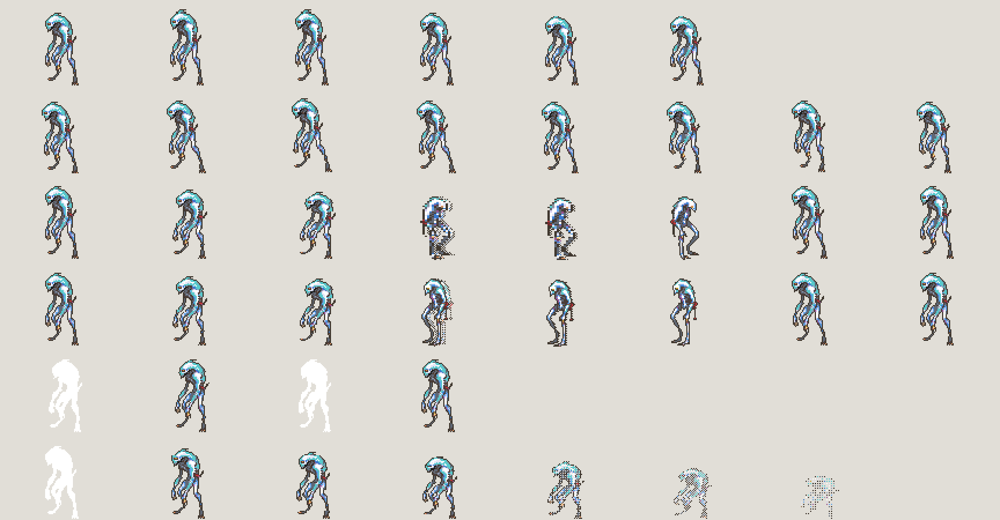
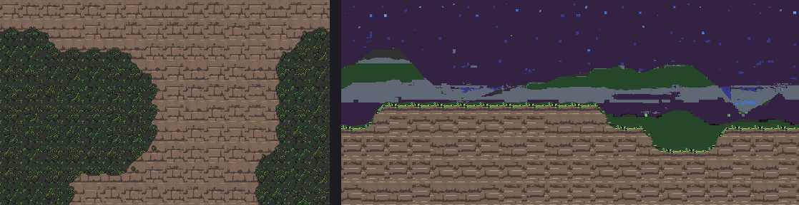
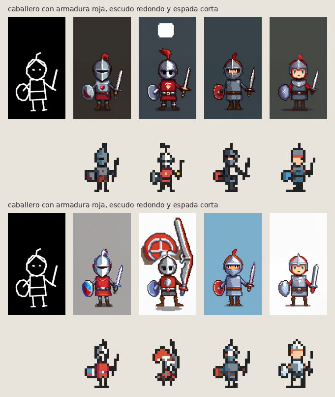
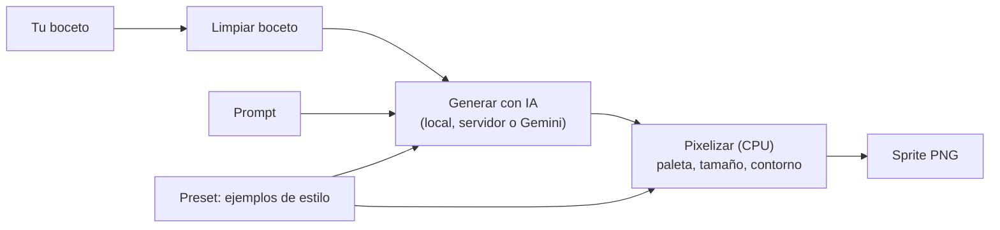

# Forja de Sprites

Convierte tus **bocetos en sprites pixel art** listos para un juego 2D. Dibujas la
forma, describes al personaje en español y obtienes variantes que se parecen a tu
boceto, comparten la atmósfera del juego y usan **exactamente la paleta** de tu estilo.
Después las animas y generas el terreno (para Tiled).

[English README](README.en.md) · [Motores de IA](docs/motores-ia.md) · [Inicio rápido](docs/inicio-rapido.md)



*Por cada boceto (izquierda): 4 variantes. Arriba, la imagen de la IA; abajo, el sprite
final ya con la paleta del estilo.*

## Por qué es distinta

- **El estilo lo pone el código, no la IA.** La IA solo dibuja la imagen grande; el
  recorte y el pixelizado (paleta exacta, tamaño, contorno) son locales y
  deterministas. Todos tus personajes salen coherentes.
- **Tres motores de IA intercambiables** (ver abajo): tu GPU, un servidor propio o
  Gemini. Cambiar de motor no cambia el estilo del juego.
- **Un preset de estilo se define con 2–5 sprites de ejemplo.** Sin entrenar nada.
- **Pensada para el flujo completo del juego:** proyectos, animaciones, hoja de
  sprites (PNG + JSON Aseprite), mapas para Tiled.

## Motores de IA

| | Librerías (local) | Servidor propio | Gemini |
|---|---|---|---|
| Qué es | SDXL + ControlNet + IP-Adapter en tu GPU | Qwen-Image en tu red | API de Google |
| Coste / privacidad | Gratis, nada sale de tu equipo | Gratis, nada sale de tu red | De pago, se envían boceto y texto |
| Clave | No | No | Sí (secreta, fuera del repo) |
| `--motor` | `local` | `qwen` | `gemini` |

Guía completa —configuración, manejo seguro de la clave y cómo añadir tu propio
motor— en **[docs/motores-ia.md](docs/motores-ia.md)**.

## Ejemplos incluidos (sin nada de pago ni privado)

Los presets usan sprites de **licencia libre (CC0)** ([CREDITOS.md](CREDITOS.md)):

| Preset | Tamaño | Origen |
|---|---|---|
| `aventura-16` | 16×16 | Tiny Dungeon, de Kenney |
| `heroes-mazmorra` | 16×28 | 16x16 DungeonTileset II, de 0x72 |
| `criaturas-64` | 64×64 | Openmon Monster Sprites, de Screen Smith |

Y proyectos de ejemplo en `proyectos/`. El más genérico para empezar es
**`fantasia-rpg`** (RPG de aventuras 16×16); los demás muestran otros tonos
(`mazmorra-oscura`, `horror-grotesco`, `aventura-clasica`).



*El pixelizador, sin necesidad de GPU: desde una "salida de IA" borrosa y ruidosa
(centro) recupera el sprite con la paleta del preset (derecha).*

Prueba el flujo sin IA en un minuto: [docs/inicio-rapido.md](docs/inicio-rapido.md).

## Qué incluye

### Animación

Genera, de una en una, reposo, caminar, ataques, daño y muerte; se añaden a la hoja
del personaje. En los ataques el golpe puede ser una deformación del sprite, una pose
dibujada por la IA o una pose que dibujas tú. Exporta hoja PNG + JSON (formato
Aseprite) y GIFs. [docs/animacion.md](docs/animacion.md)



### Mapas

Suelos sin costuras con variantes y transiciones (vista cenital), bloques de
plataforma y fondo en capas (vista lateral), con la paleta del proyecto. Exporta el
tileset PNG + `.tsx` de Tiled con bordes automáticos. [docs/mapas.md](docs/mapas.md)



### Proyectos

Cada proyecto fija la ambientación, el estilo de píxel y los tipos de personaje; el
mismo boceto en dos proyectos da resultados con tonos distintos y la misma paleta.
[docs/proyectos.md](docs/proyectos.md)



## Cómo funciona



Detalle en [docs/arquitectura.md](docs/arquitectura.md).

## Requisitos

- Python 3.11 o superior.
- Para el motor local: GPU con 12–16 GB de VRAM y ~14 GB de disco para los modelos
  (en CPU funciona, pero muy lento). AMD: [docs/gpu-amd.md](docs/gpu-amd.md).
- Sin GPU puedes usar el pixelizador, los presets, la animación procedural y los
  mapas, o un motor externo (Gemini / servidor propio).

## Instalación

```bash
git clone https://github.com/tapiagarrido/spriteforge.git
cd spriteforge
python3 -m venv .venv
.venv/bin/pip install -e '.[dev]'            # motor base (CPU): presets, pixelizador, servidor

# Solo para el motor local de IA: PyTorch para tu GPU + dependencias + modelos
.venv/bin/pip install torch torchvision --index-url https://download.pytorch.org/whl/cu124   # NVIDIA
# AMD: ver docs/gpu-amd.md
.venv/bin/pip install -e '.[ia]'
.venv/bin/forja-modelos descargar
```

## Uso

```bash
.venv/bin/forja-servidor            # app en http://127.0.0.1:8765
```

Dibuja o importa el boceto, describe el personaje y genera. También hay ventana de
escritorio ([docs/app.md](docs/app.md)). Desde la terminal:

```bash
.venv/bin/forja-generar ejemplos/bocetos/guerrero_digital.png --proyecto fantasia-rpg \
    --prompt "caballero con armadura roja, escudo redondo y espada corta" --variantes 4
# otros motores: --motor qwen | --motor gemini   (ver docs/motores-ia.md)
```

Los resultados quedan en `salidas/<fecha>_<descripcion>/` (ignorada por git).
Pixelizar una imagen cualquiera con un preset:

```bash
.venv/bin/forja-pixelizar mi_personaje.png --preset presets/aventura-16 --ver 8
```

Crear tu propio estilo con tus sprites: [docs/presets.md](docs/presets.md).

## Desarrollo

```bash
.venv/bin/pytest          # tests (sin GPU: usan una IA falsa y APIs simuladas)
.venv/bin/ruff check .    # estilo de código
```

La integración continua (`.github/workflows/ci.yml`) ejecuta ambos en cada push.
Guía para contribuir: [CONTRIBUTING.md](CONTRIBUTING.md) · seguridad y claves:
[SECURITY.md](SECURITY.md).

## Estructura

```
motor/        Motor en Python (boceto, presets, pixelizar, generar, animar, mapas, servidor…)
  gemini.py   Motor externo: API de Gemini        qwen.py   Motor: servidor Qwen-Image propio
  generar.py  Tubería local (SDXL + ControlNet)   config.py Ajustes y clave (fuera del repo)
app/          Interfaz (HTML/CSS/JS) y ventana de escritorio (Tauri 2)
presets/      Estilos de píxel de ejemplo (CC0)
proyectos/    Proyectos de juego de ejemplo
plantillas/   Tipos de personaje comunes
ejemplos/     Bocetos de prueba
scripts/      Demos y banco de pruebas
tests/        Tests (pytest)
docs/         Documentación
```

## Documentación

- [Inicio rápido](docs/inicio-rapido.md)
- [Motores de IA: local, servidor propio y Gemini](docs/motores-ia.md)
- [Arquitectura y decisiones](docs/arquitectura.md)
- [Proyectos de juego y parecido al boceto](docs/proyectos.md)
- [Presets de estilo](docs/presets.md)
- [Generación con IA](docs/generacion.md) · [Pixelizador](docs/pixelizador.md)
- [Modelos y licencias](docs/modelos.md) · [GPU AMD](docs/gpu-amd.md)
- [Gemini](docs/gemini.md) · [Qwen-Image](docs/qwen.md)
- [Animación](docs/animacion.md) · [Rediseñar variantes](docs/rediseno.md)
- [Mapas](docs/mapas.md) · [Mapa grande](docs/mapa-grande.md)
- [API local](docs/api.md) · [App de escritorio](docs/app.md)
- [Registro de cambios](CHANGELOG.md)

## Créditos y licencia

Código bajo licencia MIT ([LICENSE](LICENSE)). Los sprites de ejemplo son CC0:
[CREDITOS.md](CREDITOS.md). Los modelos de IA tienen sus propias licencias:
[docs/modelos.md](docs/modelos.md).
