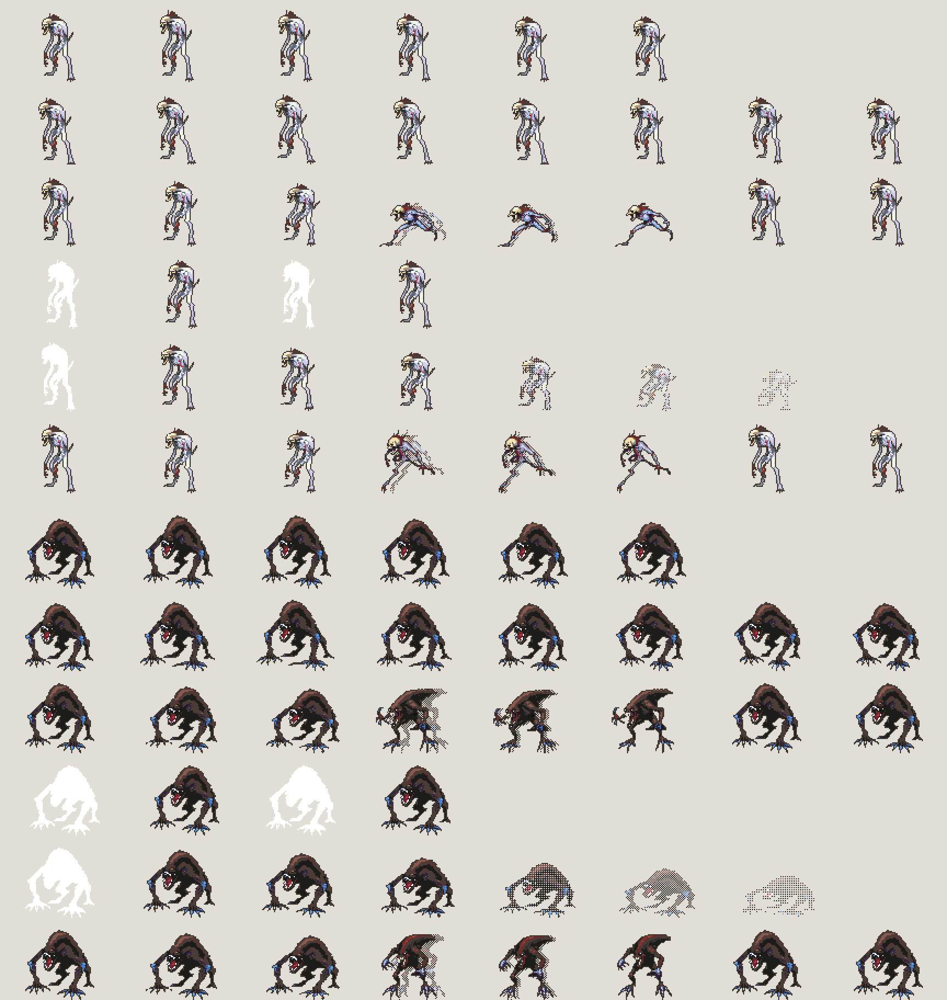

# Animación

Tras elegir una variante, se generan sus animaciones **de una en una**. Cada
animación es una **secuencia de fotogramas** que se ve en orden (tira) y
reproduciéndose, y se añade a la hoja de sprites del personaje. Regenerar una
animación la reemplaza; se pueden borrar. Hay dos técnicas que se combinan:

| Técnica | Qué hace | Coste | Animaciones |
|---|---|---|---|
| **Procedural** (`motor/animar.py`) | Deforma el propio sprite, píxel a píxel | CPU, < 1 s | reposo, caminar, ataque, daño, muerte |
| **Golpe dibujado** (`motor/animar_ia.py`) | La IA (o tú, en el lienzo) dibuja la pose del golpe de un ataque | GPU, ~14 s | ataque, zarpazo, rugido, ataque especial descrito |



*Cada fila es una animación (reposo, caminar, ataque, daño, muerte, zarpazo). En
"ataque" y "zarpazo" el golpe es una pose dibujada por la IA.*

## Animación procedural

Cada fotograma se construye con un **mapeo inverso y vecino más cercano**: para
cada píxel del fotograma se busca de qué píxel del sprite viene. Nunca se
interpola, así que no aparecen colores nuevos, los bordes siguen nítidos y el
personaje es exactamente el mismo.

Las deformaciones se miden desde los pies:

| Parámetro | Efecto |
|---|---|
| `dx`, `dy` | desplazamiento (hacia donde mira / hacia arriba) |
| `sx`, `sy` | estirar o encoger (desde los pies) |
| `inclinacion` | la cabeza se adelanta o se echa atrás (cizalla) |
| `piernas`, `brazos` | tijera del tercio inferior / balanceo de la parte media |
| `cabeza` | cabeceo del tercio superior |
| `destello` | todo el sprite al color más claro (daño) |
| `estela` | copia tramada desplazada hacia atrás (ataque) |
| `disolucion` | elimina píxeles con trama Bayer 4×4 (muerte) |
| `temblor` | desplazamiento aleatorio de ±1 px (impacto) |

| Animación | Fotogramas | Bucle | Qué hace |
|---|---|---|---|
| reposo | 6 | sí | respiración: estira/encoge el cuerpo y cabecea |
| caminar | 8 | sí | rebote, inclinación hacia delante, piernas en tijera |
| ataque | 8 | no | anticipación (atrás), embestida con estela, impacto con temblor, recuperación |
| daño | 4 | no | destello blanco y retroceso |
| muerte | 8 | no | destello, colapso y disolución |

**Hacia dónde mira** se detecta (la cabeza suele ir adelantada respecto al cuerpo)
y se puede forzar. Las embestidas avanzan en esa dirección.

## Golpe de los ataques

En los ataques eliges **cómo se obtiene la pose del golpe**:

| Opción | Qué pasa |
|---|---|
| Automática (deformación) | el propio sprite hace el movimiento de ese ataque (rápido, siempre coherente): **ataque**, embestida hacia delante; **zarpazo**, la garra delantera sube y baja en arco; **rugido**, se yergue con la cabeza atrás y tiembla; **especial**, carga con destellos y descarga |
| Dibujada por la IA | la IA dibuja una pose nueva; si no te gusta, **Otra pose de la IA** prueba otra |
| Mi dibujo del lienzo | dibujas la pose en el lienzo y la IA la sigue (la forma más fiable de un movimiento concreto) |

El zarpazo procedural gira la **parte delantera de la figura** (lo que está por
delante del centro, desde algo por encima de los pies) alrededor de un "hombro",
con un peso que crece hacia delante y hacia arriba: en un humanoide se mueve el
brazo, en una bestia agazapada su pata delantera y en un gusano la cabeza, mientras
las patas traseras y los pies se quedan quietos. No inventa colores (mapeo inverso).

La procedural no puede abrir la boca ni redibujar la anatomía; la pose de la IA sí:

1. SDXL genera la pose con el prompt original + la acción
   (`attacking, lunging forward, jaws wide open, claws extended…`), con una
   **semilla propia de cada acción** (si no, con la misma semilla el zarpazo, la
   embestida y el rugido salían con la misma pose).
2. **Identidad**: IP-Adapter completo con la imagen de la variante como referencia
   (0.5 por defecto, ajustable con "Parecido al personaje").
3. **Cuerpo**: ControlNet sigue un boceto. Si dibujas la pose en el lienzo, ese
   (fuerza 0.75): es la forma más fiable de obtener un movimiento concreto. Si no,
   **el boceto original del personaje**, con poca fuerza (0.45) y solo en el primer
   35 % de los pasos: fija el cuerpo (cuántas patas, bestia agazapada o gusano) y
   deja cambiar la postura. Sin esa guía, una criatura no humanoide acababa
   convertida en un humanoide genérico (con la descripción vacía, el texto solo dice
   "criatura monstruosa") y la animación parecía colapsar; guiando con el contorno del
   propio sprite o partiendo de su imagen, la pose apenas cambiaba.
4. Se recorta, se le **transfieren los tonos** de la imagen original (Reinhard en
   CIELAB, solo sobre la figura) y se pixeliza **solo con los colores del sprite
   base y a su misma escala**.

5. Si la IA la dibujó mirando al otro lado, se voltea para que mire como el personaje.

La animación del ataque queda: anticipación (procedural, desde el sprite base) →
golpe con la pose dibujada (entra con estela, tiembla en el impacto) → recuperación
(vuelta al sprite base). El salto entre dibujos es deliberadamente seco, como en la
animación clásica de juegos.

### Lo que se aprendió probando

| Intento | Resultado |
|---|---|
| Partir de la imagen deformada (img2img 0.6) + ControlNet de la pose + identidad 0.6 | Identidad perfecta, pero **la pose no cambia** |
| Más fuerza img2img (hasta 0.92) | La pose sigue sin cambiar: la referencia completa fija también la postura |
| Fuerza 1.0 (sin partir de la imagen) + identidad 0.35 | Poses nuevas y variadas, pero el personaje **deriva** (otro color, otra complexión) |
| Fuerza 1.0 + identidad 0.5–0.65 + transferencia de color | **Poses nuevas y mismo personaje** (configuración actual) |

## Direcciones (exploración, como el mapa de Pokémon)

Para moverse por un mapa cenital, cada personaje necesita su vista **de frente**
(abajo), **de espaldas** (arriba) y **de lado** (derecha; la izquierda es su espejo).
En *Animación › Direcciones* cada vista se obtiene con:

| Botón | Qué hace |
|---|---|
| IA / Otra (IA) | la redibuja con la identidad de la variante, con el motor elegido en *Motor de IA* |
| Mi dibujo | la IA sigue lo que haya en el lienzo como boceto de esa vista (lo más fiable) |
| Variante | usa la variante tal cual (si ya está de lado, o casi de frente) |

Después eliges la **Dirección** al animar y se guarda como `caminar_abajo`,
`ataque_arriba`, `muerte_derecha`… La derecha genera también la izquierda en espejo
(y se borran juntas). En la hoja, las animaciones quedan ordenadas por dirección.

De frente y de espaldas cambian los movimientos que dependen del eje: **caminar**
alterna los pies (sin la tijera lateral), el **ataque** va hacia el espectador (crece y
baja) o hacia el fondo (se aleja y sube), y el **zarpazo** cruza de un lado a otro.

**Qué motor usar para las vistas.** SDXL (la IA local) no es un modelo de giro de
objetos: dibuja imágenes nuevas a partir de texto. Medido con dos monstruos y un roedor:

| Cómo se le pide a la IA local | Resultado |
|---|---|
| Partiendo de la imagen de la variante (img2img, fuerza 0.55-0.85) | conserva la criatura al 100 %, pero **no gira**: queda igual que la base |
| Desde cero, sin descripción | gira algo, pero **inventa otra criatura** (un gusano acabó como un humanoide agachado) |
| Desde cero, **con descripción** de la criatura | conserva la especie, pero el ángulo no es fiable: pidiendo «de espaldas» seguía mostrando la cara |

Por eso la interfaz tiene un campo opcional para **describir la criatura** (mejora la
identidad con la IA local) y avisa de que girar bien es cosa de Gemini. No es un fallo
corregible con ajustes: es el límite del modelo. **Gemini** sí dibuja una
vista de espaldas de verdad conservando la identidad; si la variante ya está casi de
frente, la mantiene así (para un mapa visto desde arriba ese ángulo vale como "abajo":
usa «Variante»). Para una pose concreta, «Mi dibujo». Cada vista se pixeliza con los
colores y la escala de la variante.

Se guardan en `<resultado>/direcciones_XX/` (`abajo.png`, `ia_abajo.png`, `abajo.json`…).

## Exportación

Por variante se crea `salidas/<carpeta>/animacion_XX/`:

| Archivo | Contenido |
|---|---|
| `<animacion>/frame_XX.png` | la secuencia de cada animación + `meta.json` (duraciones, bucle, golpe) |
| `hoja.png` | todos los fotogramas, una fila por animación (se reconstruye al añadir o borrar) |
| `hoja.json` | formato de Aseprite (frames con duración + `frameTags` por animación): lo leen Phaser, Godot (con plugins), Unity… |
| `hoja_x4.png` | la hoja ampliada para verla |
| `<animacion>.gif` | vista previa ampliada ×4 de cada animación |
| `animacion.json` | resumen: lienzo, dirección, fotogramas, duraciones |

Las poses de golpe dibujadas se guardan en `salidas/<carpeta>/claves_XX/`.

## Uso

En la app, en el editor de la variante, sección **Animación**: elige la animación
(y, si es un ataque, cómo se obtiene el golpe) y pulsa **Generar animación**. Se
muestra la secuencia y se reproduce; abajo, **Animaciones del personaje** lista
las guardadas (clic para verlas, botón para borrarlas). Si retocaste el sprite,
pulsa antes "Guardar sprite": se anima el retoque.

Terminal (solo procedural):

```bash
.venv/bin/forja-animar salidas/<carpeta>/sprite_01.png -o salidas/<carpeta>/animacion_01 [--mira izquierda]
```

API: `POST /api/animar` (una animación, en cola), `GET /api/animaciones/<carpeta>/<n>`
y `POST /api/animaciones/borrar` (ver [api.md](api.md)).

## Límites

- La animación procedural es una deformación: sirve muy bien para reposo, pasos,
  golpes y muertes; el zarpazo mueve la parte delantera como un bloque (no sabe
  dónde está el codo). Para movimientos complejos, dibuja las poses clave.
- Las poses de la IA varían; con más "parecido al personaje" se conserva mejor el
  aspecto pero cambia menos la postura. Usa "Otra pose" o dibuja tú la pose.
