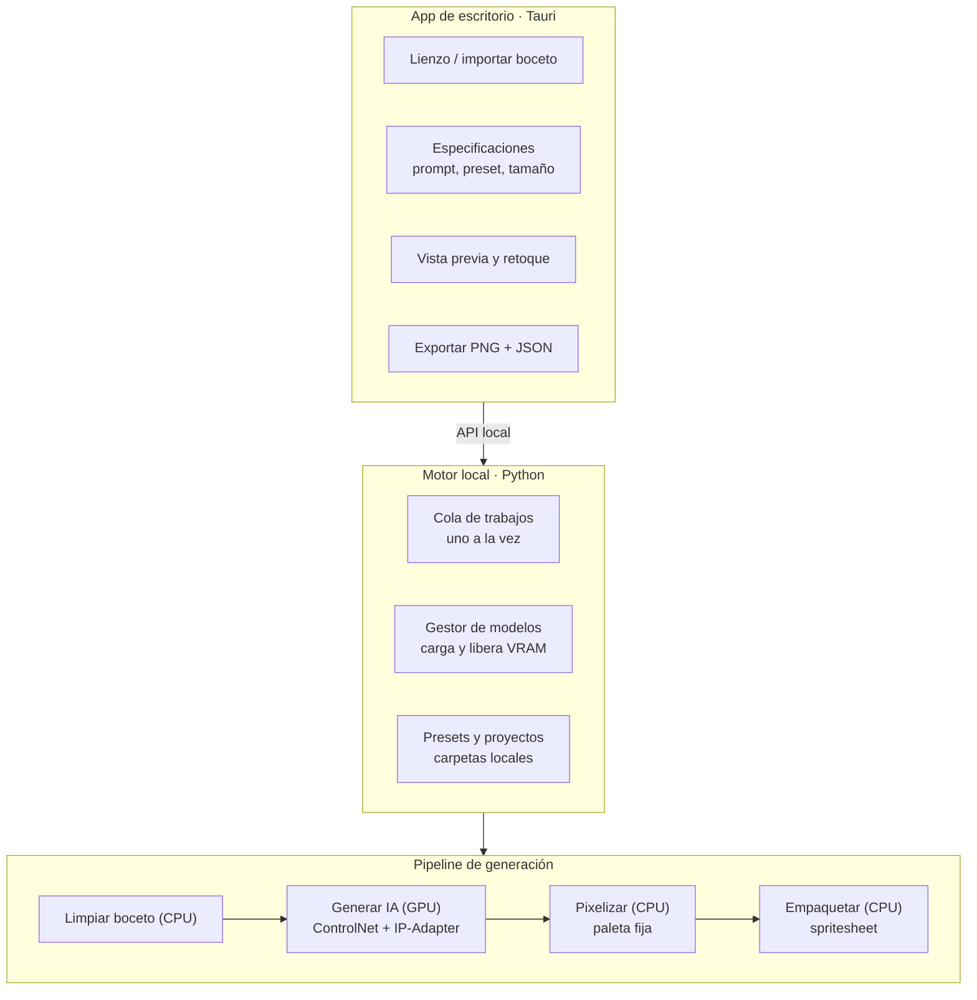

# Arquitectura

## Objetivo

Generar personajes pixel art para juegos **a partir de bocetos propios**, en local,
con un estilo coherente y sin necesidad de entrenar modelos. Requisito transversal:
**bajo consumo de recursos**.

## Visión general

### Componentes

| Componente | Responsabilidad | Estado |
|---|---|---|
| `motor/presets.py` | Analiza los sprites de ejemplo y escribe `estilo.json` | Hecho |
| `motor/pixelizar.py` | Convierte una imagen grande en un sprite que cumple el preset | Hecho |
| `motor/color.py` | Color: hex/RGB, CIELAB, color más cercano | Hecho |
| `motor/boceto.py` | Foto o dibujo → trazo limpio para ControlNet | Hecho |
| `motor/modelos.py` | Catálogo y descarga de modelos | Hecho |
| `motor/generar.py` | Tubería SDXL + ControlNet + IP-Adapter + LoRAs; gestor de VRAM | Hecho (falta probar en GPU) |
| `motor/forja.py` | Cadena completa y carpeta de resultados | Hecho |
| `motor/servidor.py` | API local (HTTP en `127.0.0.1`) + cola de trabajos | Hecho |
| `app/ui/` | Interfaz: lienzo, especificaciones, variantes, editor de píxeles | Hecho |
| `app/src-tauri/` | Ventana de escritorio que arranca el motor | Código hecho, falta compilar |

## Las tres entradas de una generación

| Entrada | Controla | Técnica |
|---|---|---|
| Boceto | Forma, pose, proporciones | ControlNet (scribble / lineart) |
| Preset (3 ejemplos) | Estilo: contorno, sombreado, detalle | IP-Adapter en modo "solo estilo" |
| Prompt | Detalles del personaje | Texto |

Además, el preset aporta datos que se aplican **de forma exacta** en el pixelizado
(no aproximada como en la IA): paleta, tamaño del lienzo, alto de la figura, color
y grosor del contorno, número de colores.

## Decisiones

### Tauri en lugar de Electron
Tauri usa el motor web del sistema: la app abierta ocupa del orden de decenas de MB
de RAM frente a cientos con Electron. La interfaz se escribe igual (HTML/JS).

### Motor en Python con `diffusers`, sin ComfyUI
El ecosistema de modelos de imagen está en Python. Usar `diffusers` directamente es
más ligero y fácil de empaquetar que levantar ComfyUI como servidor intermedio.

### Modelo: SDXL con pocos pasos
SDXL con la LoRA SDXL-Lightning (8 pasos), ControlNet scribble, IP-Adapter plus en
modo InstantStyle y la LoRA pixel-art-xl. Se genera con un área de ~768² px (576×1024
para sprites 16×28), suficiente porque el resultado se reduce a 16–64 px. Flux da
más calidad pero consume bastante más; queda como opción. Detalle en
[generacion.md](generacion.md).

### API con la biblioteca estándar
El servidor usa `http.server` en lugar de FastAPI/uvicorn: cero dependencias
extra para una API local de una sola usuaria. La cola de un solo hilo garantiza
una generación a la vez.

### La GPU solo cuando se genera
El gestor de modelos carga los pesos al recibir un trabajo y los libera tras un
tiempo sin uso. Una cola de un solo trabajo evita que dos generaciones compitan por
la VRAM. Todo lo demás (limpiar, pixelizar, empaquetar) es NumPy en CPU.

### Fondo de generación calculado
El preset calcula `fondo_generacion`: el color más alejado de su paleta. Se pide a
la IA que dibuje sobre ese fondo, lo que hace trivial separar figura y fondo.

### Presets sin entrenamiento
Tres ejemplos coherentes bastan para guiar el estilo con IP-Adapter. Si más adelante
hay 15–30 sprites propios, se puede entrenar una LoRA y el preset la referenciará.

## Hoja de ruta

1. **Fase 1** — Boceto → sprite: presets ✅, pixelizador ✅, generación IA ✅, API ✅,
   interfaz ✅, ventana Tauri (código ✅), instalador autónomo.
2. **Fase 2** — Direcciones y poses: el personaje generado como referencia +
   ControlNet OpenPose para frente, lado y espalda.
3. **Fase 3** — Animación: frames clave con pose fija y la misma limpieza de paleta;
   exportación a spritesheet + JSON (Aseprite, Godot, Phaser).
4. **Fase 4** — Historias: un modelo de texto local (p. ej. vía Ollama) lee un
   fragmento del relato y propone la descripción del personaje como prompt.
