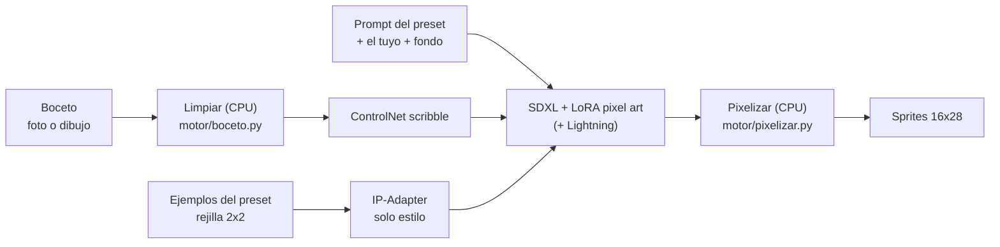

# Generación con IA

`motor/generar.py` convierte el boceto limpio en imágenes de 512–1024 px con el
estilo del preset. Después, `motor/pixelizar.py` las convierte en sprites.

## Cadena completa



| Pieza | Para qué |
|---|---|
| **SDXL 1.0** (fp16) | Modelo base de imagen |
| **ControlNet scribble** (xinsir) | Obliga a respetar la forma y la pose del boceto |
| **IP-Adapter plus** en modo *InstantStyle* | Imita el estilo de los ejemplos sin copiar su contenido |
| **LoRA pixel-art-xl** | Empuja la salida hacia pixel art |
| **LoRA SDXL-Lightning** | 8 pasos en lugar de ~30 (modo rápido) |
| **VAE fp16-fix** | Evita imágenes negras/NaN al decodificar en fp16 |

## 1. Limpieza del boceto (`motor/boceto.py`)

ControlNet scribble espera **trazo blanco sobre negro** de grosor uniforme.

1. **A tinta**: si el PNG tiene transparencia se usa el alfa. Si es una foto, se
   normaliza la iluminación (dividir por una versión muy desenfocada elimina
   sombras y el tono del papel) y se umbraliza. Si la foto incluye la mesa o un
   fondo oscuro alrededor del papel (zonas oscuras grandes que tocan el borde), se
   excluye del cálculo y se quita lo que cuelga de él (anillas del cuaderno): si
   entrara, el umbral separaría "negro frente a papel" y el lápiz se tomaría por
   papel. El umbral es el de Otsu o, si es más permisivo, el del **triángulo** sobre
   lo que no es papel saturado, que funciona con lápiz suave (mucho papel y poco
   trazo, donde Otsu falla).
2. **Motas y restos de la foto**: se eliminan componentes diminutos (polvo,
   textura), las líneas rectas, largas **y finas** (bordes del papel, de la mesa),
   lo que toca el borde de la imagen y lo que queda entero en el margen (texto).

**Ilustraciones y renders.** Si la entrada no es un boceto de líneas sino una imagen
sombreada (más del 25 % de la imagen útil es claramente más oscura que su fondo; en
un boceto es < 10 %), se convierte en contornos: la silueta (del segmentador, que
no depende del color del fondo ni de que el sujeto toque los bordes) más los bordes
internos fuertes. En ese caso no se aplican los filtros de fotos de papel.
3. **Encuadre**: se recorta al dibujo y se centra en el lienzo de generación con
   un 8 % de margen, apoyado abajo como el sprite final.
4. **Simplificar trazos** (`simplificar`, 0–1, por defecto 0,3): un boceto a lápiz
   tiene trazos repetidos, sombreado y líneas casi paralelas que, al engrosarlos,
   se funden en manchas; ControlNet las interpreta como masas y no como contornos.
   Se cierran los huecos entre trazos cercanos (cierre morfológico con un radio
   proporcional a `simplificar`) y se reduce todo a su **esqueleto** de 1 px
   (adelgazamiento de Zhang-Suen): cada grupo de trazos queda como una sola línea
   limpia. Comparado en 4 bocetos (lápiz, tinta, digital e ilustración): 0,3 da las
   mejores líneas; desde 0,6 se pierden detalles pequeños (dedos, ojos). Con 0 se
   desactiva (útil para dibujos digitales ya limpios). Se probó también una
   extracción por diferencia de gaussianas (DoG) y no mejoró: el problema no era
   detectar líneas sino que las densas se fundían al engrosarlas.
5. **Grosor** (`grosor`, 0,2–2 % del lado mayor; por defecto 0,6 %): las líneas se
   engrosan de forma uniforme. Más fino conserva detalle; más grueso fuerza más la
   silueta.

En la app, **"Cómo lo verá la IA"** (bajo el lienzo) muestra este resultado en vivo
(`POST /api/boceto`) y permite ajustar ambos valores antes de generar.

```bash
.venv/bin/forja-boceto foto.jpg -o limpio.png --ancho 576 --alto 1024
.venv/bin/forja-generar boceto.jpg --simplificar 0.3 --grosor 0.006 ...
```

## 2. Generación (`motor/generar.py`)

- **Tamaño**: proporción del sprite (16:28) con un área de ~`resolucion_generacion`²
  y lados múltiplos de 64. Para el preset de héroes: 576×1024.
- **Prompt**: `pixel art, plain white background, <tu descripción>, <resto del
  prompt_base del preset>`. El orden importa: CLIP da más peso a lo primero y
  descarta lo que pase de 77 tokens, así que lo imprescindible va delante.
- **Fondo blanco, sin nombrar otros colores**: con "solid blue background" la IA
  teñía de azul la armadura y hasta la piel del personaje.
- **Referencia de estilo**: los ejemplos en una rejilla 2×2 cuadrada (el
  codificador de IP-Adapter recorta al centro), ampliados sin suavizado sobre
  fondo blanco.
- **InstantStyle**: el IP-Adapter solo actúa en el bloque `up.block_0` de la UNet,
  que codifica el estilo; así el contenido lo deciden el boceto y el prompt.

### Modos

| Modo | Pasos | Guía (CFG) | LoRA Lightning | Prompt negativo |
|---|---|---|---|---|
| `calidad` (por defecto) | 28 | 6.0 | no | sí |
| `rapido` (borrador) | 8 | 1.0 | sí | no se usa (CFG 1) |

El modo borrador es 5 veces más rápido, pero sin prompt negativo la IA suele
pintar fondos grises con sombras y suelos, que dificultan separar la figura.

### Parámetros que más influyen

| Parámetro | Dónde | Efecto |
|---|---|---|
| `parecido_boceto` | proyecto / preset / app / `--parecido-boceto` | 0 libre … 1 calcado; controla fuerza y duración de ControlNet ([proyectos.md](proyectos.md)) |
| `fuerza_estilo` | preset / app / `--fuerza-estilo` | 0 ignora los ejemplos; 0.3 por defecto. Por encima de ~0.5 copia **contenido** (todos los personajes salían con el casco y el penacho del caballero de referencia) |
| `fuerza_pixel_art` | preset | Peso de la LoRA de pixel art |
| `resolucion_generacion` | preset | Más alto = más detalle y más VRAM/tiempo |
| semilla | app / `--semilla` | Misma semilla + mismos parámetros = mismo resultado |

## Descripciones en español

El codificador de texto de SDXL apenas entiende español ("monstruo grotesco hecho
de hilos" producía un hombre genérico). Si la descripción parece española se
traduce al inglés con un modelo local (Helsinki-NLP opus-mt-es-en, ~300 MB, CPU,
< 1 s). La app muestra la traducción usada; `--sin-traducir` lo desactiva.

## Separación figura/fondo con segmentador

Tras generar, cada imagen pasa por **BiRefNet lite** (MIT, ~180 MB, ~0.3 s), un
modelo entrenado para recortar sujetos sobre cualquier fondo. Resolvió los casos
en que la separación por color fallaba: personajes oscuros sobre fondos oscuros
(habitual en proyectos sombríos), fondos con trama y figuras claras de contorno
suave. Si el modelo no está instalado se usa la separación por color con ayuda de
la silueta del boceto (`--sin-segmentador` la fuerza).

## Lo que se aprendió probando (resumen)

Ajustes hechos con generaciones reales del mismo boceto y varias descripciones:

| Problema observado | Causa | Solución |
|---|---|---|
| Personaje teñido de azul | "blue background" en el prompt | Fondo blanco, sin nombrar colores |
| Todos con casco y penacho | `fuerza_estilo` 0.6: IP-Adapter copiaba contenido | Bajar a 0.3 |
| Sprites ilegibles a 20 px | Personajes con proporciones y detalle realistas | Prompt "chibi, huge head, minimal detail" |
| Fondos grises, sombras, suelos, marcos | Sin prompt negativo (modo borrador) | Modo calidad por defecto + negativo específico |
| Objetos de fondo pegados (arcos, nubes) | Aleatorio según la semilla | Varias variantes por generación |
| Personaje genérico con descripción en español | CLIP no entiende español | Traducción local automática |
| Marco alrededor del personaje | Bordes del papel y la mesa de la foto convertidos en trazos | Limpieza que descarta bordes, líneas rectas largas y texto del margen |
| Sprites rotos en proyectos oscuros | "dark" oscurece también el fondo; la separación por color falla | Segmentador BiRefNet |
| Se perdía la cara (pocos píxeles) | Al reducir colores se fusionaba el menos usado | Se fusiona primero lo poco usado *y* parecido a otro color |

`scripts/experimentos.py` permite repetir este tipo de comparación: carga los
modelos una vez y genera con varias configuraciones y las mismas semillas.

## Memoria (VRAM)

- Los modelos se cargan con la primera generación y se **liberan tras 5 minutos**
  sin uso (`--minutos-inactividad`), o al pulsar "Liberar VRAM" en la app.
- Una sola generación a la vez (cola).
- `--ahorro-vram` activa la descarga a CPU de los componentes que no se están
  usando (`enable_model_cpu_offload`): usa bastante menos VRAM a costa de tiempo.
- La VAE decodifica de una en una y por mosaicos: decodificar 4 imágenes de
  576×1024 de golpe no cabe en 16 GB junto a la UNet y el ControlNet.
- Sin GPU funciona en CPU, pero tarda muchos minutos por imagen.
  `FORJA_CPU_BF16=1` reduce la RAM necesaria a la mitad (~13 GB).

## Uso desde la terminal

```bash
.venv/bin/forja-generar ejemplos/bocetos/guerrero_foto.jpg \
    --preset presets/heroes-mazmorra \
    --prompt "knight with red armor, round shield and a short sword" \
    --variantes 4
```

El resultado queda en `salidas/<fecha>_<descripcion>/` con el boceto, el boceto
limpio, la referencia de estilo, las imágenes de la IA, los sprites y un
`info.json` con todos los parámetros para poder reproducirlo.
