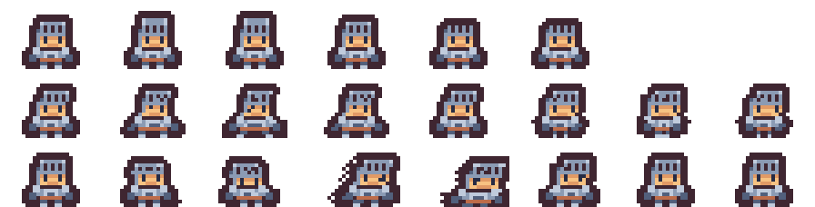

# Inicio rápido (sin GPU)

Recorrido con el proyecto de ejemplo **`fantasia-rpg`** y sprites CC0 incluidos.
No necesita GPU ni claves.

```bash
python3 -m venv .venv
.venv/bin/pip install -e '.[dev]'
```

## 1. Mira los estilos y proyectos de ejemplo

```bash
.venv/bin/forja-proyectos listar
# aventura-clasica   [preset: heroes-mazmorra]
# fantasia-rpg       [preset: aventura-16]      ← punto de partida
# horror-grotesco    [preset: criaturas-64]
# mazmorra-oscura    [preset: criaturas-64]
```

Un **preset** (`presets/aventura-16/`) son 2–5 sprites de ejemplo + `estilo.json` con
la paleta, el tamaño y el contorno. Un **proyecto** (`proyectos/fantasia-rpg.json`)
añade la ambientación del juego y apunta a un preset.

## 2. Pixelizar: de imagen grande a sprite del estilo

```bash
.venv/bin/python scripts/demo_pixelizado.py presets/aventura-16 demo.png
```

Simula una "salida de IA" (ampliada, borrosa, con ruido y colores corridos) y la
devuelve a un sprite con la paleta del preset: [demo](img/demo_aventura16.png).
Con una imagen tuya: `forja-pixelizar imagen.png --preset presets/aventura-16 --ver 8`.

## 3. Animar un sprite

```bash
.venv/bin/forja-animar presets/aventura-16/ejemplo2_caballero.png -o animacion \
    --animaciones reposo caminar ataque
```

Genera GIFs por animación, `hoja.png` y `hoja.json` (formato Aseprite):



## 4. Crear tu propio estilo

```bash
mkdir presets/mi-estilo
cp mis_sprites/*.png presets/mi-estilo/        # ejemplo1.png, ejemplo2.png…
.venv/bin/forja-preset analizar presets/mi-estilo --nombre "Mi estilo"
.venv/bin/forja-preset vista presets/mi-estilo
```

Y un proyecto: copia `proyectos/fantasia-rpg.json`, cambia `nombre`, `preset` y
`ambientacion`. Más en [presets.md](presets.md) y [proyectos.md](proyectos.md).

## 5. Añadir IA para bocetos → sprites

Elige un motor (puedes tener los tres) y sigue [motores-ia.md](motores-ia.md):

```bash
forja-generar ejemplos/bocetos/guerrero_digital.png --proyecto fantasia-rpg \
    --prompt "guerrero con escudo y espada" --motor local     # o qwen / gemini
```

## 6. La app

```bash
.venv/bin/forja-servidor     # http://127.0.0.1:8765
```

## Tests

```bash
.venv/bin/pytest -q          # sin GPU: usan una IA falsa y APIs simuladas
```
