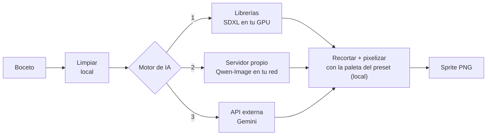

# Motores de IA: local, servidor propio y Gemini

La Forja separa **qué hace la IA** de **lo que hace siempre el código**. Solo un paso
cambia según el motor: *generar la imagen grande a partir del boceto*. Todo lo demás
(limpiar el boceto, traducir, recortar la figura, pixelizar con la paleta exacta del
preset, animar, mapas) es local y determinista, así que **el estilo del juego no
cambia aunque cambies de motor**.



| | 1. Librerías (local) | 2. Servidor propio (Qwen) | 3. Gemini (API) |
|---|---|---|---|
| Dónde corre | Tu GPU, dentro del proceso | Otra app/máquina de tu red | Servidores de Google |
| Coste | Gratis | Gratis | De pago según tu cuenta |
| Privacidad | Nada sale de tu equipo | Nada sale de tu red | **Se envían boceto y descripción** |
| Clave | No | No | Sí (**secreta**) |
| Velocidad | ~10–45 s por 4 variantes | ~30–100 s por imagen | Depende de la red y de tu cuenta |
| Control del boceto | Muy alto (ControlNet) | Medio (modo edición) | Medio (guía de pose) |
| Requisitos | GPU 12–16 GB, ~14 GB de modelos | Servidor compatible en marcha | Cuenta y clave de Google AI Studio |
| Extra | — | Girar al personaje, poses | Editar variantes con texto |
| Se elige con | `--motor local` | `--motor qwen` | `--motor gemini` |

Se elige por generación en **Especificaciones → Motor de IA**, o con `--motor` en la
terminal. No hace falta tener los tres.

---

## 1. Librerías (IA local en tu GPU)

La tubería se monta con las bibliotecas `diffusers`, `transformers` y `peft` sobre
PyTorch: SDXL + ControlNet *scribble* (respeta tu pose) + IP-Adapter (imita el estilo
de los ejemplos del preset) + LoRA de pixel art. Es el motor por defecto y el más
fiel al boceto.

```bash
pip install -e '.[ia]'                      # diffusers, transformers, peft…
# PyTorch aparte, según tu GPU (ver docs/gpu-amd.md para AMD):
pip install torch torchvision --index-url https://download.pytorch.org/whl/cu124   # NVIDIA
forja-modelos descargar                     # ~14 GB, a modelos/ (no va a git)
forja-generar boceto.png --proyecto fantasia-rpg --prompt "mago con túnica azul" --motor local
```

Detalles: [generacion.md](generacion.md) (cadena completa), [modelos.md](modelos.md)
(pesos y licencias), [gpu-amd.md](gpu-amd.md).

**Buenas prácticas**

- Los pesos nunca se suben al repositorio (`modelos/` está en `.gitignore`).
- Revisa las licencias de cada modelo antes de redistribuir nada
  ([modelos.md](modelos.md)).
- Sin GPU funciona en CPU, pero muy lento; para probar el resto del flujo sin IA
  usa los tests, que traen una IA falsa.

---

## 2. Servidor propio (Qwen-Image u otro)

La Forja puede hablar con un servidor de imágenes que tú mismo arranques (en esta
máquina o en otra de tu red). El caso probado es **Qwen-Image** servido con
[stable-diffusion.cpp](https://github.com/leejet/stable-diffusion.cpp), pero sirve
cualquier servidor que cumpla este contrato mínimo:

| Ruta | Para qué |
|---|---|
| `GET /api/health` | Comprobación. Devuelve JSON, p. ej. `{"sd": true}` |
| `POST /v1/images/edits` | `multipart/form-data` con `prompt`, `size` (`512x768`), `n`, `output_format` e imágenes `image[]`. Responde `{"data": [{"b64_json": "<png>"}]}` (estilo OpenAI) |

Configuración:

1. Arranca tu servidor.
2. En **Ajustes → Qwen** escribe su dirección y pulsa **Probar conexión**; o define
   `QWEN_URL=http://192.168.1.20:1234` (tiene prioridad). Por defecto `http://127.0.0.1:1234`.
3. Elige **Qwen-Image** en *Motor de IA*, o `--motor qwen`.

Más detalle y mediciones en [qwen.md](qwen.md).

**Buenas prácticas**

- Es HTTP sin cifrar ni autenticación: úsalo en `127.0.0.1` o en una red de
  confianza; **no lo expongas a internet**.
- No hay clave que proteger, pero la dirección se guarda en tu configuración de
  usuario (fuera del repo).

---

## 3. Gemini (API externa)

Genera la imagen con la API de Gemini de Google. Es opcional y **de pago según tu
cuenta**. A Google se envían el boceto, la rejilla de ejemplos del preset y un texto
con la descripción y la ambientación del proyecto; las imágenes devueltas llevan la
marca de agua invisible SynthID. Detalle técnico: [gemini.md](gemini.md).

```bash
export GEMINI_API_KEY="…tu clave de Google AI Studio…"   # o pégala en Ajustes → Guardar clave
forja-generar boceto.png --proyecto fantasia-rpg --prompt "esqueleto con lanza" --motor gemini
```

### Cómo manejar la clave (lo que hay que hacer, y lo que no)

| Sí | No |
|---|---|
| Guardarla en **Ajustes** (queda en `~/.config/forja-sprites/config.json`, permisos `600`, fuera del repo) o en la variable `GEMINI_API_KEY` | Escribirla en un archivo del proyecto, un `.env` versionado, un script o un test |
| Usar claves de prueba **falsas** en los tests (`AIzaFAKE-…`) | Pegarla en issues, capturas, logs o mensajes de commit |
| Limitar la clave y poner un presupuesto/alerta en tu cuenta de Google | Reutilizar la misma clave en varios proyectos |
| **Revocarla y crear otra** si sospechas que se filtró (borrarla del historial de git no basta) | Subir tu `config.json` o tu `.env` a GitHub |

Cómo la protege el código: la API local **nunca devuelve la clave** (solo si existe y
sus 4 últimos caracteres), viaja a Google en la cabecera `x-goog-api-key` (no en la
URL), y no se escribe en logs ni en `info.json` de las salidas.

---

## Añadir tu propio motor

El punto de extensión es un **generador**: una función que recibe una `Peticion`
(boceto limpio, rejilla de referencia, prompt, prompt negativo, tamaño, nº de
variantes y semilla; ver `motor/generar.py`) y devuelve una lista de imágenes
`PIL.Image` RGB. `forjar(...)` acepta un `generador=` propio y se encarga del resto:

```python
from PIL import Image
from motor.forja import forjar

def mi_generador(peticion) -> list[Image.Image]:
    # Llama a tu servicio y devuelve peticion.variantes imágenes
    return [llamar_a_mi_servicio(peticion.boceto, peticion.prompt, semilla=peticion.semilla + i)
            for i in range(peticion.variantes)]

forjar(boceto, preset, "mago con túnica azul", generador=mi_generador)
```

Para que aparezca como opción en la app, añade tu módulo (por ejemplo
`motor/mi_motor.py`, siguiendo `motor/qwen.py` o `motor/gemini.py`), incluye su nombre
en `MOTORES_IA` de `motor/forja.py` y conéctalo en `forjar`. Cubre el cliente con
tests que simulen la red, como `tests/test_qwen.py` y `tests/test_gemini.py`.
