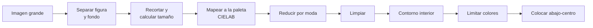

# Pixelizador

`motor/pixelizar.py` convierte una imagen grande (normalmente la salida de la IA, de
512–1024 px) en un sprite que cumple el preset: tamaño, paleta, número de colores y
contorno. Es NumPy puro, en CPU; tarda del orden de décimas de segundo por imagen.

## Por qué hace falta

Los modelos de imagen generan algo que *parece* pixel art, pero no lo es: los
"píxeles" no siguen una rejilla, aparecen colores intermedios, bordes suavizados y
ruido. Reescalar sin más produce colores sucios. El pixelizador fuerza las reglas
del estilo de forma exacta.

## Pasos



0. **Corregir el tinte** (opcional). Si se conoce el fondo pedido a la IA y el
   fondo medido se le parece, el desplazamiento de color entre ambos se resta a
   toda la imagen.
1. **Separar figura y fondo** (`mascara_figura`). Si la imagen trae transparencia,
   se usa el alfa. Si no, el fondo **crece desde los bordes**: un píxel pasa a ser
   fondo si un vecino ya lo es y sus colores difieren menos de `tolerancia_fondo`
   (delta E). Así se siguen los degradados, viñeteados, sombras suaves y suelos que
   pintan las IAs, y el crecimiento se detiene en el contorno del personaje.
   Detalles que lo hacen robusto con salidas reales:
   - Se calcula a 512 px con el color suavizado (contra el ruido).
   - Se ignora un 4 % exterior: a veces la IA dibuja un marco pegado al borde.
   - Límite de seguridad: solo puede ser fondo lo que se parezca a alguno de los
     colores del borde (agrupados con k-medias), para que el fondo no se cuele por
     un hueco del contorno en una figura de color parecido.
   - Si la figura sale ocupando casi toda la imagen (fondo con textura), se
     reintenta suavizando más.
   - Se quitan motas y piezas sueltas pequeñas (nubes, restos), y se **rellenan
     los huecos** por los que el fondo se coló a través de canales estrechos.
   Rellenar desde fuera respeta zonas interiores del color del fondo (unos ojos
   blancos sobre fondo blanco).
2. **Recortar y calcular el tamaño.** La figura se recorta a su caja y se escala,
   conservando la proporción, para caber en `ancho × alto_figura`.
3. **Mapear a la paleta.** Cada píxel toma el color más cercano de la paleta del
   preset en espacio CIELAB (perceptual).
4. **Reducir por moda.** Cada píxel final cubre un bloque de la imagen original y
   toma el color **más frecuente** del bloque, no la media; así no se inventan
   colores intermedios. Es opaco si la figura cubre al menos `umbral_alfa` del
   bloque. Solo votan los píxeles del *núcleo* de la figura (sin la franja que se
   mezcla con el fondo), para que ese halo no aporte colores falsos.
5. **Limpiar.** Se eliminan píxeles opacos aislados y se rellenan agujeros de 1 px.
6. **Contorno interior.** El anillo exterior de la silueta pasa a ser el color de
   contorno. Si la IA ya dibujó contorno coincide con él (no se duplica); si no, se
   crea.
7. **Limitar colores.** Mientras haya más de `max_colores`, el color menos usado se
   fusiona con el más parecido. El color del contorno nunca se fusiona.
8. **Colocar.** La figura se apoya abajo y se centra en horizontal en el lienzo.

## Parámetros (`Opciones`)

| Parámetro | Por defecto | Descripción |
|---|---|---|
| `ancho`, `alto` | del preset | Lienzo del sprite |
| `alto_figura` | del preset | Alto máximo del personaje |
| `paleta` | del preset | Colores permitidos |
| `max_colores` | `colores_por_sprite.objetivo` | Máximo de colores, contorno incluido |
| `contorno`, `grosor_contorno`, `color_contorno` | del preset | Contorno forzado |
| `tolerancia_fondo` | 5 | Delta E máximo entre vecinos para que el fondo avance |
| `fondo_esperado` | `fondo_generacion` del preset | Referencia para corregir el tinte |
| `umbral_alfa` | 0.5 | Cobertura mínima de un bloque para ser opaco |
| `limpiar` | sí | Quitar píxeles sueltos y agujeros |

Uso desde Python:

```python
from PIL import Image
from motor.pixelizar import Opciones, pixelizar

op = Opciones.desde_preset("presets/heroes-mazmorra", alto_figura=18)
resultado = pixelizar(Image.open("salida_ia.png"), op)
resultado.imagen.save("sprite.png")
print(resultado.colores, resultado.tamano_figura)
```

## Calidad medida

`scripts/demo_pixelizado.py` simula una salida de IA (ampliación a 512 px,
desenfoque gaussiano, ruido y corrimiento de color) a partir de los ejemplos del
preset y compara el resultado con el original:

| Ejemplo | Píxeles idénticos al original |
|---|---|
| Caballero | 95 % |
| Elfa | 94 % |
| Mago | 65 % (barba blanca sin contorno sobre fondo blanco, ver limitaciones) |

La métrica (`coincidencia`) compara las figuras recortadas a su caja, de modo que un
desplazamiento de 1 px dentro del lienzo no penaliza.

## Banco de pruebas

`scripts/banco_pruebas.py` pixeliza **los 25 personajes del pack** (22 no están en el
preset) bajo cuatro escenarios simulados y mide la coincidencia con el original:

```bash
.venv/bin/python scripts/banco_pruebas.py \
    assets/referencias/0x72_dungeontileset_ii/0x72_DungeonTilesetII_v1.7/frames \
    --preset presets/heroes-mazmorra --patron '*_idle_anim_f0.png' --hoja docs/img/banco_pruebas.png
```

Los escenarios usan el fondo de generación del preset (blanco), salvo "fondo claro"
(crema):

| Escenario | Simula | Media | Peor caso |
|---|---|---|---|
| limpio | sprite ampliado, sin degradar | 95 % | 48 % |
| ia típica | desenfoque 3 px, ruido, leve corrimiento de color | 91 % | 47 % |
| ia mala | desenfoque 6 px, mucho ruido, corrimiento fuerte | 68 % | 37 % |
| fondo claro | como "ia típica" pero sobre fondo crema | 71 % | 36 % |

Tiempo medio: ~250 ms por imagen de 512 px en CPU.

Lectura de los resultados:

- 23 de 25 personajes se recuperan casi idénticos con entradas razonables, también
  los que el preset no conoce y en otros tamaños (16×16 a 32×36).
- Los peores casos son siempre los dos **magos**: su barba blanca no tiene contorno
  y toca directamente un fondo blanco o crema, así que es indistinguible del fondo.
  Con salidas reales de la IA no ocurre, porque la IA sí dibuja ese contorno.
- Historial: la versión 0.1 (fondo azul, comparación con un único color de fondo)
  daba 99/91/55/88 %. Se cambió al crecimiento de región porque esa versión fallaba
  con los fondos reales de la IA (degradados, sombras, suelos, marcos).

## Con salidas reales de la IA

Con la configuración actual (modo calidad, fondo blanco), en 12 generaciones de
tres personajes distintos la figura se separa bien en 10–11 de cada 12. Los fallos
restantes son objetos de fondo pegados al personaje (un arco, una nube grande).
`docs/img/resultados_ia.png` muestra un ejemplo completo.

## Limitaciones conocidas

- Si la figura tiene zonas del mismo color que el fondo **y** tocan el borde de la
  silueta sin contorno, el fondo puede comérselas (armadura gris sobre fondo gris,
  barba blanca sobre fondo blanco).
- Objetos de fondo que tocan al personaje se consideran parte de la figura.
- Los detalles más finos que un píxel final (líneas de 1 px en la imagen reducida)
  pueden perderse en la votación; es inherente a reducir 30 veces.
- El contorno interior sustituye el anillo exterior de la silueta: en figuras muy
  finas (2 px de ancho) casi todo queda como contorno.
